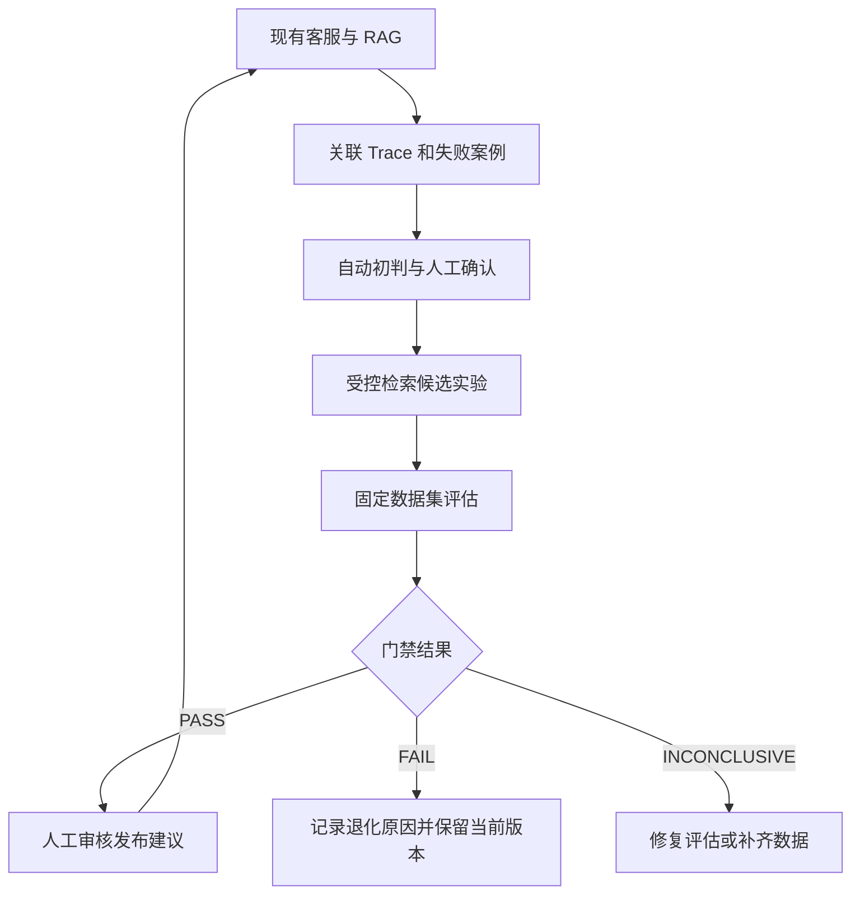

# 智能客服项目增量优化方案（按当前仓库修订）

> **目标：** 复用当前已实现的客服、RAG、Langfuse、数据飞轮和离线评估能力，补上可追踪的失败案例诊断、受控检索候选实验和回归门禁。
>
> **范围：** 本文是实施计划。代码已存在不等于本次新增；评估产物是历史参考，不等于当前基线；只有实际运行并留存结果后才报告效果。

## 1. 当前代码核对

| 能力 | 当前状态 | 实施时的处理 |
|---|---|---|
| LangGraph State、路由与工作流 | 已有 `app/graph/` | 仅按新增诊断需要扩展，先检查字段和 reducer |
| 混合检索、RRF、重排、查询拆分 | 已有 `app/core/retrieval.py`、`app/core/rerank.py`、`app/kb/milvus_client.py` | 以可注入候选参数为改造重点；底层融合目前不是通用权重配置 |
| 置信度、语义检查、拒答闸 | 已有 `app/core/confidence.py`、`app/core/selfcheck.py` | 复用现有信号和拒答行为，不另建同类闸 |
| Langfuse Trace 和意图标记 | 已有 `app/core/observability.py`、`app/graph/runtime.py` | 复用回调和会话关联；新增稳定的应用级案例关联键 |
| 点踩反馈、低置信案例和召回快照 | 已有 `app/api/feedback.py`、`app/db/models.py`、`app/graph/runtime.py` | 复用现有反馈入口与快照；点踩只作为线索，不作为错误标签 |
| 飞轮标准化、查重、人工审核和知识写回 | 已有 `app/core/flywheel.py`、`app/api/review.py`、`app/kb/dualwrite.py` | 复用既有队列和审核流程；新增失败类型分流时保持人工审核边界 |
| RAG 评估及报告 | 已有 `scripts/eval_ch04.py`、`tests/data/eval_ch04.jsonl`、`data/ch04/reports/rag_eval.json` | 复用指标实现；重新运行后才生成新基线 |
| 飞轮趋势、置信度校准和成本报表 | 已有 `scripts/eval_flywheel.py`、`scripts/calibrate_confidence.py`、`scripts/cost_by_intent.py` 等 | 本计划不重复建设 |
| 候选配置实验和回归发布门禁 | 尚未发现对应实现 | 本计划新增 |
| 统一失败诊断及人工确认状态 | 尚未发现独立案例模型和诊断模块 | 本计划新增；不把当前低置信池误当成完整诊断系统 |

当前 RAG 报告包含 300 条样本，记录的生成时间为 2026-08-07；混合重排整体 Recall@5 为 0.983、MRR 为 0.894，跨文档桶为 0.933 和 0.657。它可用于了解旧结果和发现关注点，不能直接作为新门禁基线。正式实施前应重新运行，并核对数据、知识库和模型版本。

## 2. 目标与设计原则

本次改造交付一个小型、可复现的质量迭代流程：

原则：

1. 复用现有 State、检索、Langfuse、低置信记录、审核队列和评估代码。
2. 自动诊断是初判；证据不足时用 `unknown`，由人工确认后再统计诊断准确率。
3. 候选配置必须实际传入检索实现，并记录生效参数，不能只增加配置文件。
4. 用验证集选择候选，用独立测试集作最终比较；测试集不用于反复调参。
5. 先产生发布建议和报告；生产发布、知识写入和灰度操作仍需人工控制。
6. 不因提高回答率而放宽拒答和证据约束；不报告未测量的质量、性能或成本收益。
7. 人工审核按聚合后的问题簇和风险策略进行，不要求逐条审核所有原始对话；只有需要知识或策略变更的内容进入相应审核。

### 人工审核负载控制

- 复用现有 `flywheel.py` 的问题标准化/查重和 `review_queue`：每个标准化知识缺口作为一个审核簇，重复案例累加出现次数，原始案例和检索快照保留在详情中并可追溯到诊断案例。不要另建一套重复的聚类队列。对新诊断类别扩展归并时，聚类不确定或样例冲突应标记待复核，不自动批量处理。
- 由可配置的“问题类别审核策略”决定审核粒度：明确、低风险且证据一致的问题簇可由人工审核一次代表样例和拟议知识后批量处理，并抽查成员案例；高风险、低置信、来源冲突或答案不一致的问题仍需逐条复核。
- 工具故障、路由错误等运维类问题进入技术排查队列，不要求知识审核；只有涉及知识库或策略变更的结论才进入对应审批流程。
- 人工审核工作台优先呈现按频次、风险、近期增长和置信度排序的问题簇，并提供“批准此簇 / 拆分 / 退回补充 / 忽略”操作及审计记录。类别级策略只定义审核规则，不代表整类问题可无条件写入知识库。
- 诊断模型质量通过分层抽样和定期抽查衡量，不要求人工确认每一个在线初判；抽样结果不足或误差偏高时，提高该类别的抽查比例或切换为逐条审核。

## 3. 阶段一：失败案例关联与诊断（P0）

### 3.1 交付目标

建立统一案例记录，能从案例追到一次请求的 Trace、问题、关键检索结果、证据检查结果、最终答复和人工反馈；给出有依据的自动初判，并支持人工确认、纠正或标为信息不足。

### 3.2 案例标识和存储

- 在请求入口生成稳定的应用级 `case_id`，贯穿该请求的 Graph 调用、日志/案例存储和 Langfuse metadata。不要假设 Langfuse 生成的 Trace ID 已在 Graph State 中可直接读取。
- 记录 Langfuse Trace ID 的方式应基于当前锁定版本的公开 API 或回调能力验证；如果无法可靠取得，`case_id` 仍须可以在 Langfuse metadata 中搜索，并在案例记录中保存 Trace 链接/标识。
- 使用独立持久化案例表或等价存储保存诊断状态；不要把完整日志或大段原文塞入 State。先确定是否扩展现有 `low_confidence_questions`，还是新建 `failure_cases`，避免两套重复队列。
- 建议字段：`case_id`、`trace_id`（可空）、`conversation_id`、`intent`、`failure_type`、`diagnosis_status`、`diagnosis_reason`、检索文档 ID/排名/分数、置信度信号、自检结果、工具状态、答案/拒答摘要、反馈、人工标签、配置版本、时间戳。
- 保存检索快照时只保留诊断所需字段；遵循脱敏、访问控制和数据保留策略。当前 State 的 `retrieved_snapshot` 是 Top 3 且不含文档 ID，不能直接满足候选排名诊断；需确认从 Trace 输出取数还是扩展结构化快照。

### 3.3 初判类型和标注规则

建议类型：`retrieval_miss`、`rerank_error`、`evidence_insufficient`、`generation_error`、`tool_error`、`routing_error`、`knowledge_gap`、`unknown`。

- 自动初判必须包括理由、引用字段和置信/确定程度；人工确认状态与失败类型分开存储。
- `retrieval_miss` 与 `rerank_error` 需依赖正确证据来源标注：正确证据未进入候选集才可标召回失败；进入候选集但排名不够才可标排序失败。
- `knowledge_gap` 需经人工审核或标准知识来源确认。低置信度、零命中、拒答和用户点踩都只能提供线索，不能单独证明知识缺口或回答错误。
- 线上失败案例的诊断确认采用按类别配置的抽样和升级策略，不逐条审核全部案例；建立离线诊断准确率标注集时仍须对抽样样本作可靠人工标注。
- 现有知识缺口簇由标准化问题及 `review_queue` 表示，审核详情展示归并原话、频次和检索快照，并关联诊断案例。后续只补类别策略、抽样审计与工作量统计；不得重复实现已有去重链路。
- 信息不足、多个原因无法区分或反馈仅反映体验时，允许 `unknown` / `insufficient_data`。
- 为避免类别定义重叠，为每个类型补充正例、反例和优先判定规则；尤其区分“证据内容本身不足”和“知识库缺少信息”。

### 3.4 样本与验收

不要预设一定能从线上取得 30 条异常请求。先盘点 Langfuse/低置信池中的可用记录与脱敏条件，再用分层人工标注集验证；每类样本不足时明确报告，不用总体准确率掩盖缺类。

验收项：

- 每个案例可通过 `case_id` 找到对应的请求记录和关键阶段信息；Trace 关联失败时有明确状态，不伪造 Trace ID。
- 自动诊断保存理由和依据字段，缺少真值时不自动确认为 `retrieval_miss` 或 `knowledge_gap`。
- 标注指南、样本版本和人工标签可追溯；报告各类别精确率/召回率或混淆矩阵，并单列 `unknown` 比例。
- 报告线上原始案例数、聚合问题簇数、去重比例、每类待审簇数、人工抽查覆盖率及升级为逐条审核的比例，用于验证审核负载是否随重复数据有效下降；不能以聚合代替诊断质量标注。
- 用户点踩与自动失败分类分别统计。

## 4. 阶段二：检索候选实验（P0）

### 4.1 先建立候选参数接口

当前 `search_knowledge()` 的主要参数是策略、`top_k`、类别过滤等；召回数量和重排数量仍受全局设置控制，底层 hybrid 使用固定 RRF。因此先让检索参数可以显式传入，并记录实际生效值。不要先承诺任意 RRF 权重调优或型号约束已经可用。

建议新增：

- `app/core/optimization_candidates.py`：候选配置模型、合法范围和配置版本。
- 对 `app/core/retrieval.py` / `app/kb/milvus_client.py` 做最小参数注入：候选召回深度、最终重排数量；只有实现并验证后，再加入额外参数。
- `scripts/eval_candidates.py`：对同一验证集运行基线和候选配置，输出总体/分桶指标、样本差异、有效参数和运行元数据。

第一轮只选一到两种假设明确的变更，例如 `rerank_top_k` 或召回深度；型号精确匹配、动态按意图选参数、RRF 权重等作为后续实验，单独提出并验证。

### 4.2 数据集及指标口径

- 现有 `tests/data/eval_ch04.jsonl` 是 300 条 RAG 评估集；当前没有看到对应独立的验证集与最终测试集。实施时新增带版本/哈希的划分，或经审核确定现有集合只用于验证并另建测试集。
- 初次复核发现运费规则冲突，之后用户确认为未满包邮门槛收 6 元；修正结果与重算记录见本计划末尾 2026-10-22 运费规则修正条目。历史评估报告保留原样，不能把旧的 10 元预期当作当前业务规则。
- 最终门禁要求测试评估报告附带独立来源清单：数据集哈希一致、人工标注、记录审核者和题目来源，并明确未从历史评估集派生、未曾评估、未用于候选调参。清单模板为 `data/ch11/test_dataset_provenance.example.json`；历史切分集没有此资格。
- 评估集保留当前五类：政策、型号、口语、跨文档、该拒答。可回答题需标注正确证据来源；跨文档题需标注必需来源集合；拒答题需记录拒答原因。
- 复用 `eval_ch04.py` 的现有 section 级匹配与跨文档计算逻辑，并在报告中说明定义。若改成文档 ID 级 Recall，必须先补足标注，再明确作为口径变更，不能直接与旧数值比较。
- 报告 Recall@K、MRR 和当前覆盖度/回答/拒答指标，并同时展示总体与五类分桶。跨文档同时报告“命中任一必需来源”和“覆盖全部必需来源”。
- 延迟、错误率和成本只有在采集口径、样本范围和来源稳定后才纳入门禁；现有离线 RAG 报告并不自动提供这些指标。

### 4.3 可复现元数据

每次运行保存：代码提交 SHA、候选配置及哈希、评估集版本/哈希、知识库快照/版本、嵌入与重排模型版本、聊天模型及生成参数、运行时间、实际样本数、失败/跳过样本和指标。`eval_candidates.py --dataset-provenance` 会把来源清单及规范化 SHA-256 写入报告；最终门禁检查清单内容与数据哈希。随机生成评估需固定参数；LLM Judge 记录模型与 Prompt 版本，并抽样人工复核。

验收项：

- 一条命令运行基线和至少两个候选；候选值确实到达检索调用。
- 报告有总体和分桶 Recall@K/MRR，并给出配置差异及失败样本。
- 能按运行元数据复现比较；用验证集选配置，独立测试集只作最终报告。

## 5. 阶段三：离线回归门禁（P1）

新增 `scripts/eval_release_gate.py` 和版本化门槛配置。门禁读取结构化评估报告，检查数据与版本信息后输出：

- `PASS`：所有硬门槛满足，评估数据完整。
- `FAIL`：至少一个已定义硬门槛不满足。
- `INCONCLUSIVE`：关键指标/版本缺失、样本不足、运行失败或基线与候选无法公平比较。

第一版优先使用现有且已有口径的指标：Recall@K、MRR、Answer Coverage、Faithfulness、应拒答误放率、错误拒答率。安全门槛需明确分子、分母和样本范围；其它指标的允许退化幅度必须从重跑基线和重复运行波动中确定，不能凭空设值。延迟、成本、分类器 Micro/Macro-F1 只在相应测量链路纳入后增加。

门禁实现要求：

1. 将零值与缺失值区分；禁止缺失指标默认通过。
2. 比较前核对评估集、知识库、模型和配置元数据；不一致时 `INCONCLUSIVE`。
3. 报告每条门槛的实测值、阈值、通过状态和原因。
4. `FAIL` 与 `INCONCLUSIVE` 都不得给出可发布建议。
5. 第一版只产生评估结果和发布建议，不自动改生产配置、不自动发布或回滚。

## 6. 阶段四：接入既有飞轮（P1）

复用当前 `low_confidence_questions` → `flywheel.py` → `review_queue` → 人工审核 → `dualwrite` 的流程。当前飞轮已将相似知识缺口标准化并归并到同一 `review_queue` 项，记录出现次数，详情展示关联原话/快照并可追溯诊断案例；当前诊断接入也只将人工确认的 `knowledge_gap` 送入该队列。因此新增工作是为诊断类别定义审核策略、抽样和风险升级，并提供工作量指标，不另建问题簇或队列。具体分流如下：

| 类型 | 建议处理方向 |
|---|---|
| `knowledge_gap` | 聚合成问题簇；低风险且证据一致时审核代表样例及拟议知识后批量进入现有审核/知识写回流程，并抽查成员案例；冲突、高风险或低置信时逐条审核 |
| `retrieval_miss` | 检查切分、元数据、过滤和召回深度 |
| `rerank_error` | 检查候选集、排序输入和排序位置 |
| `evidence_insufficient` | 检查跨文档证据组合和拒答条件 |
| `generation_error` | 检查提示、上下文、答案要点和忠实度 |
| `tool_error` | 检查参数、权限、超时、业务错误和重试 |
| `routing_error` | 检查意图标签、路由规则和相关用例 |
| `unknown` | 人工复核；不触发自动知识或策略变更 |

人工答案仍须脱敏、去重、核对范围和冲突，并经审核后才能写入知识库。批量审核只对审核通过的问题簇及其明确成员生效，不能仅凭类别名称批准新知识。任何知识或策略更新都需记录来源案例、问题簇、审核人/结论和版本，再运行固定评估。

## 7. 实施顺序与交付

| 顺序 | 工作项 | 交付物 | 完成标准 |
|---|---|---|---|
| 1 | 固化现状和评估口径 | 模块清单、数据集说明、重跑基线 | 不重复实现已存在能力；基线有版本元数据 |
| 2 | 案例 ID、Trace 关联和案例存储设计 | 数据模型/API 设计 | 能追踪案例，不依赖未经验证的 Trace ID 获取方式 |
| 3 | 初判及人工标注流程 | 诊断逻辑、标注规范和验证报告 | 不足以判断时为 unknown；报告分类型结果 |
| 4 | 候选参数注入及离线比较 | 候选模型、评估脚本、对比报告 | 参数确实生效；验证集比较可复现 |
| 5 | 回归门禁 | 门禁脚本、门槛配置和报告 | 退化被拦截；缺数据时为 INCONCLUSIVE |
| 6 | 完善现有审核飞轮 | 复用现有归并队列；增加类别审核策略、抽样/升级和工作量统计 | 不重复建设聚合；按类别配置审核/抽查；高风险逐条升级；回归验证可定位案例、审核项和知识版本 |
| 7 | 文档与演示 | 运行说明、示例结果 | 可从干净环境按说明复现主要流程 |

## 8. 第一版最小可交付版本

- [x] 生成应用级 `case_id`，把请求、Graph 阶段记录和 Langfuse Trace 可搜索地关联起来。
- [x] 保存包含检索排序信息的最小失败案例记录，支持自动初判、`unknown` 和人工确认。
- [x] 对检索候选参数做最小可用注入，在有版本记录的验证集上运行基线和至少两个候选配置。
- [x] 建立独立最终测试集，避免用调参集成绩作为最终效果。
- [x] 输出结构化对比报告和门禁结果；版本不一致、评估失败或指标缺失时不得通过。
- [x] 复用现有问题簇，支持按诊断类别配置人工抽样和高风险逐条升级；工作量报告包含原始案例数、审核簇数、去重率和抽查覆盖率。
- [x] 复用现有人工审核流程；第一版不做自动发布、自动改生产配置或自动回滚。

## 9. 风险与简历描述边界

1. 低置信度、点踩和拒答都不等价于事实错误或知识缺口。
2. 相关性/重排分数不是正确概率；如用于置信门槛，需用独立数据校准。
3. 对同一数据反复调参会造成评估泄漏；必须分开验证集和测试集。
4. LLM Judge 会有误差；固定模型和 Prompt，并抽样人工核验。
5. 案例记录可能包含个人信息和业务信息；明确脱敏、访问和保留规则。
6. 未测量的延迟、成本或质量变化不得写成收益。

只有代码实现、数据版本和实验结果齐备后，才能描述为“构建了评估驱动的优化闭环”。若实际只完成 Trace 关联或离线候选评估，简历应按已完成范围表述，不提前声称自动优化、灰度发布或回滚。

## 10. 当前执行记录（2026-10-20）

- 2026-10-22 复核：`flywheel.py` / `review_queue` 已实现标准化去重、同类问题合并计数、原始问题与快照详情和诊断案例反向关联；因此本方案复用现有问题簇。开始时 Docker 容器已停止，后按用户要求启动 Docker Desktop 并启动原有 MySQL、Milvus、etcd、MinIO 容器，保留原卷。核心诊断/候选/门禁/阈值测试 22 项、诊断 API 测试 2 项以及数据库审核/飞轮集成测试 8 项通过；完整回归 515 项通过。候选评估和门禁 CLI 在 `PYTHONPATH=.` 下的 `--help` 正常。
- 按用户要求继续启动了应用和两个 MCP 服务：`http://127.0.0.1:8000` 返回 HTTP 200，物流/售后 MCP 分别监听 8101/8102；应用日志确认 Milvus 预热完成。进程设置 `NO_PROXY=localhost,127.0.0.1,api.siliconflow.cn`，避开本机代理导致的 Milvus gRPC 和上游 TLS 问题。
- 本次方案修订新增类别审核策略、抽样审计和工作量指标。核对代码后确认，现有 `flywheel.py` 已进行标准化查重，`review_queue` 已承担问题簇，审核详情展示归并原话/快照并关联诊断案例；诊断接入只把人工确认的 `knowledge_gap` 送审。类别化抽样策略、风险升级和工作量统计尚未完成，不能描述为已有能力。
- 已接入应用级 `case_id`：放入 Graph State 和 Langfuse metadata，可在 Trace 中按 metadata 搜索。由于当前 callback 接口没有经验证的 Trace ID 回传钩子，`trace_id` 字段允许为空，不读取 SDK 私有状态。
- 已新增按需诊断记录、失败工具状态留痕、诊断查询/人工确认 API、初判与人工标签一致率统计和 `sql/ch11-ddl.sql`。当前自动初判仅识别工具执行失败/超时及证据闸拒答；用户点踩单独保存为 `unknown`，检索失败、排序错误、知识缺口和生成错误留给有标准证据后的人工标注。
- 已将召回深度参数传入检索器，加入基线、召回深度和重排数量候选；评估报告记录数据集哈希、知识库版本标识、知识源哈希、模型和源码指纹，并报告 Recall@5、MRR、分桶以及置信度闸拒答代理指标。
- 候选报告现包含逐样本 Recall@5/MRR/置信闸拒答变化和相对基线的差异列表，未变化样本不重复列出；评估错误仍按样本保留，供门禁判定数据不完整。
- 已新增门禁状态逻辑。必须给出经基线波动校准的总体和分桶阈值；示例阈值为空，当前会返回 `INCONCLUSIVE`。门禁只给结果，不发布。
- 新增 `scripts/calibrate_release_thresholds.py`：要求至少三次完整、同验证集/知识库/模型/代码、同 baseline 配置的运行；按中位数与最大观测偏差生成相对容忍范围，并要求运营方显式给出拒答安全绝对线和测试最小样本数。门禁校验校准与最终测试环境一致且使用不同数据哈希。该校准逻辑有合成数据单元测试，但真实重复基线尚未运行。
- 已从现有 RAG 集合生成分层验证/留出文件和来源清单。留出数据来自旧集合，而历史 ch04 报告使用过整个集合；因此它可用于本轮候选开发检查，但严格独立的最终质量声明仍需新增人工标注样本。
- 新增 ch11 DDL 在已有 MySQL 数据卷上需手动执行一次；容器初始化目录不会对已有卷重放 DDL。
- 本轮已启动本机 Docker Desktop，并复用原有 MySQL、Milvus、etcd、MinIO 容器；未删除或重建原有数据卷。已在现有 `mewhelp` 数据库手动应用 `sql/ch11-ddl.sql`，确认 `diagnosis_cases` 表存在。
- 全量自动化回归通过：`uv run --python 3.12 --group dev pytest -q`，515 项通过。测试使用本地占位模型配置，不调用真实模型服务；执行时为本机地址设置 `NO_PROXY=localhost,127.0.0.1`，避免环境代理干扰 Milvus gRPC。
- 本轮修正了 `tests/test_llm_structured.py` 中 mock 函数签名，使其接收当前 `get_chat_model` 调用的 `thinking` 参数；功能行为未变。
- 已补上诊断到既有审核飞轮的人工闸链路：只有人工确认的 `knowledge_gap` 幂等进入 `low_confidence_questions`，再由现有 `flywheel.py` 归一化/查重并落入 `review_queue`；诊断案例与审核条目双向可追溯，审核批准仍使用既有 `dualwrite`。新增一次性迁移 `sql/ch11-flywheel-link.sql`，已在本地 `mewhelp` 数据库应用。
- 新增集成回归验证“确认知识缺口 → 低置信问题池 → 飞轮查重 → 待审队列 → 诊断案例链接”，并复用既有审核 API 的测试验证人工批准写回语义。诊断 API 不会直接调用 LLM 生成并写入知识库。
- 2026-10-22 真实验证集候选对比已运行并保存到 `data/ch11/reports/eval_candidates_validation_20261022.json`。数据集为 240 条 validation 样本，三个候选最终都完整完成：baseline Recall@5=0.9852、MRR=0.8955、不可答拒答率=0.9792、可答误拒率=0.1354；`recall_20` 分别为 0.9870、0.8969、0.9792、0.1354；`rerank_5` 分别为 0.9852、0.8954、0.9792、0.1354。`recall_20` 与基线有 3 条样本指标变化，`rerank_5` 有 4 条。`rerank_5` 首轮 239/240，一条 429；单独重跑后 240/240，通过严格核对数据哈希、模型、知识库、代码和候选配置后合并，并在报告元数据中记录各候选来源报告与哈希。另一次重复 baseline 仍为 239/240（1 条 429），所以尚无三次完整基线可校准。运行时发现本机 HTTPS 代理导致 TLS EOF；将 `api.siliconflow.cn` 加入本次进程 `NO_PROXY` 后，真实嵌入/Milvus/重排调用成功。`.env` 中模型服务凭据存在且不是模板占位值；没有配置 Langfuse。
- 发布门禁以完整 validation 报告和空白示例阈值试运行，按设计返回 `INCONCLUSIVE`：数据角色不是 test、阈值未校准且缺少必需门槛。真实重复 baseline 校准、独立人工标注测试集的最终门禁及 Langfuse 在线 Trace 验收仍未完成。
- `release_thresholds.example.json` 的门槛仍为空，门禁当前应为 `INCONCLUSIVE`；需先用真实验证集重复运行基线以校准阈值。划分出的留出集源自历史 300 条集合，而该集合曾用于旧评估，因此不能据此宣称独立最终测试效果；严格质量声明仍需新增人工标注留出数据。
- 2026-10-22 继续实施：Langfuse 回调调整为每次 Graph 调用单独创建，并用应用 `case_id` 派生合法的 32 位自定义 Trace ID；诊断记录保存回调实际返回的 `last_trace_id`，Langfuse 未启用时保持为空，不生成假链接。流式、非流式及恢复调用均使用该回调；反馈入口从当前轮案例带回 Trace ID。诊断案例列表 API 增加 `failure_type` 筛选，审核者可只看指定故障类别。新增回调/追踪/类别筛选测试；修改后的全量回归 520 项通过（后续新增一项运行时追踪绑定测试尚待再次全量回归）。
- 计划启动仓库自带 Langfuse 栈以做在线 Trace 验收，并将 Web/MinIO 端口改为仅监听 `127.0.0.1`。镜像拉取未成功：Docker Desktop daemon 配置的代理 `http.docker.internal:3128` 无法连接；宿主机直连 Docker Hub 也被重置，而宿主机代理可达。没有改动 Docker Desktop 全局代理配置。暂时移除了 `.env` 中本次试加的本地 Langfuse 地址与 key，避免应用把不可达的本地服务误判为可用；在线 Trace 验收仍未完成。
- 本轮进一步增加 `failure_type` 诊断案例筛选及 `/api/diagnosis/cases/workload` 汇总：按类别统计原始案例数、待初判数、人工审核数/覆盖率、关联审核簇、待审簇和去重率；沿用既有 `review_queue`，未新建问题簇。`scripts/eval_candidates.py` 现在对 429、5xx、超时和连接错误做最多 3 次指数退避重试，终止失败仍保留在报告中供门禁拦截。新增 DB/API/候选测试 15 项、最新全量回归 523 项通过；重启应用后首页和 workload API 均返回 HTTP 200。类别级抽样策略和风险升级仍需后续实现/配置。
- 新增可配置类别审核策略 `data/ch11/diagnosis_review_policy.json`、稳定哈希抽样接口 `/api/diagnosis/cases/review-sample` 和风险升级：默认对 `unknown`/`tool_error` 全量升级，低于证据置信闸的案例升级，其它类别按配置抽样。策略只安排人工诊断质检，不会自动确认或写知识。策略读取、稳定抽样、风险升级和接口响应有新增测试；含此项变更的完整回归 527 项通过。重启应用后主页、`/workload` 和 `review-sample` 均返回 HTTP 200；目前诊断表为空，故在线样本数为 0。`/workload` 同时返回策略版本、类别抽样比例及风险门槛。
- 2026-10-22 在线观测验收：发现 Docker Desktop 手动代理保存的是旧宿主机 IP；更新 HTTP/HTTPS 代理目标并重启 Docker Desktop 后，Docker Hub 拉取成功。重启并确认原有 MySQL、Milvus、etcd、MinIO 均恢复健康，再以 Compose project `mewhelp-langfuse` 启动 Langfuse。Langfuse Web `http://127.0.0.1:3000` 返回 HTTP 200；应用 `.env` 已配置本机 Langfuse 项目 key，应用重启后生成两条真实 Trace。通过 Langfuse API 查验两条 Trace 均带 `case_id` metadata，且真实 `trace.id` 等于 `case_id` 去连字符后的 32 位值。两条在线烟测均未触发失败案例采集条件，所以线上诊断案例到 Trace 的数据关联由数据库/API 集成测试覆盖（含 trace_id 持久化和飞轮关联），未伪造用户反馈造案例。
- 在同一验证集/知识版本/代码指纹上新跑三次完整基线，报告分别为 `eval_baseline_calibration_20261022_run{1,2,3}.json`；均 240/240 完成，Recall@5 均为 0.9852，MRR 为 0.8956/0.8961/0.8945，拒答率均为 0.9792、误拒率均为 0.1354。生成 `baseline_variability_20261022.json`，记录 MRR 中位数 0.8956、最大观测偏差 0.0011；该产物只含基线波动，不填运营方安全阈值或最小样本数。门禁已加硬校验：不可回答拒答率必须有绝对下限、可回答误拒率必须有绝对上限，D_absent 分桶也必须有绝对拒答下限。
- 使用波动记录试跑门禁，结果为 `INCONCLUSIVE`：最终报告的代码指纹与基线校准指纹不同，且缺少最小样本数和绝对拒答/误拒安全线。现有 `eval_ch11_test.jsonl` 由旧评估集切分而来，旧报告曾覆盖整套来源数据，仍不能作独立最终声明；需在代码冻结后重跑一致基线/测试，并由运营方提供安全阈值。
- 最终回归（含 Trace、类别抽样/风险升级、门禁安全线校验和仅波动校准）`uv run --python 3.12 --group dev pytest -q`：529 passed。`git diff --check` 无空白错误（仅有既存换行风格提示）。最后检查 MewHelp 首页和 Langfuse Web 均 HTTP 200，原有 MySQL/Milvus/etcd/MinIO 与本地 Langfuse 六个容器均运行，应用/MCP 端口继续监听。
- 2026-10-22 门禁复核补强：门禁现在强制要求五个业务分桶齐全、每个分桶基线和候选样本完整且分桶样本数总和与报告总样本数一致；拒绝布尔值伪装为样本数/阈值，并拒绝非有限数阈值。新增 3 个回归用例。当前测试报告重跑门禁仍为 `INCONCLUSIVE`，原因为校准与报告的 `code_revision` 不一致，且运营方尚未提供最小样本数、总体拒答/误拒绝对绝对安全线及 `D_absent` 拒答下限。测试集仍来自旧评估数据切分，不能宣称独立最终质量验收。
- 2026-10-22 防止历史切分集误过门禁：评估脚本支持附带测试来源清单；门禁要求清单的规范化 SHA-256 与报告一致，并要求明确人工标注者、题目来源、未从历史评估数据派生、未曾评估且未参与候选调参。已为门禁边界新增回归用例。现有历史测试集缺少独立来源证明，因此即使哈希与验证集不同也不能获得 `PASS`。
- 最终代码冻结验证：全量回归 `536 passed`。同一验证集/知识库/代码指纹下三次 baseline 均 240/240；MRR 0.8954、0.8954、0.8961，生成 `data/ch11/reports/baseline_variability_final_20261022.json`，最大观测偏差 0.0007。最终候选报告 `data/ch11/reports/eval_candidates_validation_final_20261022.json` 中 baseline、`recall_20`、`rerank_5` 均 240/240：Recall@5 分别 0.9852、0.9870、0.9852；MRR 分别 0.8956、0.8959、0.8949；拒答率均 0.9792、误拒率均 0.1354。候选报告与校准数据集哈希及 `code_revision` 已核对一致。门禁实跑 `INCONCLUSIVE`，只因报告是 validation、校准和门禁数据相同、没有独立测试来源清单、未设置 `min_samples` 和总体/`D_absent` 拒答安全线及可答误拒绝对上限；未给发布建议。
- 2026-10-22 在线只读复核：应用 `/api/diagnosis/cases/workload` 返回 200，策略版本为 `ch11-review-v1`；当前真实诊断案例数为 0，因此线上审核抽样暂时没有自然案例。Langfuse Trace API 返回 200，最新 2 条 Trace 均带 `case_id` metadata，且 Trace ID 去连字符后与 `case_id` 一致。应用/Langfuse/MCP 端口仍在监听。
- 2026-10-22 业务确认与运费规则修正：用户确认未满 99 元的基础运费为 6 元。已修正 `data/kb/product-faq.md`、知识库录入示例、KB 页面示例、API 测试样例及 A5/E41 评估标签，并重新生成分层验证/留出集；历史 `data/ch04/reports/rag_eval.json` 保留为当时报告，不回写历史结果。使用 `kb_repatch.py` 原地更新 MySQL 中 2 个知识块并重新向量化到现有 Milvus，保留 52 条集合数据及飞轮写回块。
- 2026-10-22 运费 6 元知识版本验证：三次同环境 validation baseline 均 240/240，Recall@5 均为 0.9852，MRR 为 0.8964/0.8954/0.8964，拒答率均为 0.9792、误拒率均为 0.1354；波动记录为 `data/ch11/reports/baseline_variability_shipping6_20261022.json`。候选报告 `data/ch11/reports/eval_candidates_validation_shipping6_20261022.json`：baseline Recall@5/MRR=0.9852/0.8964，`recall_20`=0.9870/0.8969，`rerank_5`=0.9852/0.8954；各候选拒答率和误拒率一致。门禁绝对阈值仍未由运营方提供，且最终测试集仍缺独立人工标注与来源证明，因此这些 validation 结果只用于候选开发比较，不构成最终发布验收。
- 为推进最终门禁，新增 `docs/ch11-final-test-data-guide.md`，明确五类独立人工测试样本的 JSONL 标注字段、来源记录、独立性要求及评估命令；该指南不填造人工审核者或运营安全阈值。
- 2026-10-22 追加验收：运费 API 测试 `uv run --python 3.12 --group dev pytest -q tests/test_kb_api.py` 为 12 passed；用新运费版本候选报告和空白阈值模板重跑门禁，按预期 `INCONCLUSIVE`，指出 validation 角色、独立来源清单、校准元数据及运营绝对门槛缺失。`git diff --check` 通过（仅有仓库既存换行风格提示）。
- 统一初始化 SQL、烟测和挖掘样例中的旧运费后，在当前源码指纹下重新完成验证：KB API/文档测试 15 passed；三次 baseline 均 240/240，Recall@5=0.9852，MRR=0.8956/0.8956/0.8964，拒答率=0.9792、误拒率=0.1354。最新校准报告为 `data/ch11/reports/baseline_variability_shipping6_frozen_20261022.json`，MRR 最大观测偏差 0.0008；候选报告为 `data/ch11/reports/eval_candidates_validation_shipping6_frozen_20261022.json`，baseline Recall@5/MRR=0.9852/0.8956，`recall_20`=0.9870/0.8967，`rerank_5`=0.9852/0.8956。门禁校准元数据与候选报告的验证集、知识版本、代码指纹及模型完全匹配；各相对指标检查通过，但因 validation 角色、独立测试来源和运营绝对门槛仍缺，整体保持 `INCONCLUSIVE`。
- 当前修改后的完整回归 `uv run --python 3.12 --group dev pytest -q`：536 passed；workload API 与 Langfuse health 均返回 HTTP 200；`git diff --check` 通过（只有仓库既存行尾风格提示）。
- 2026-10-23 针对已知失败扩展开发回归候选：validation baseline 有 6 条 `recall_at_5 < 1`，均为 `E_multi` 跨文档问题（E1、E15、E37、E40、E44、E51）；另有 MRR<1 但 Recall@5=1 的排序较后样本，不将其误称为漏召。为 6 个漏召各加入 2 个措辞变体，生成 18 行 `tests/data/eval_ch11_failure_regression.jsonl`，清单 `data/ch11/failure_regression_manifest.json` 标记其来源于旧 validation、待人工核标签且禁止最终门禁使用。三候选初测均完整：baseline Recall@5/MRR=0.6204/0.5343，`recall_20`=0.6667/0.5367，`rerank_5`=0.6481/0.5012。该结果只用于探索已知失败家族，变体经人工核验并作为后续回归集后才适合长期比较。
- 2026-10-23 按用户要求在上述回归集基础上另建 30 题挑战集 `tests/data/eval_ch11_failure_challenge.jsonl`：保留 18 个原题/既有变体，再为六个失败主题各加两个新问法。`data/ch11/failure_challenge_manifest.json` 记录来源链、SHA-256、30 个唯一 ID、仅含 `E_multi` 以及人工复核要求，并明确禁止用于最终发布门禁。候选评估完整：baseline Recall@5/MRR=0.6722/0.5503，`recall_20`=0.7000/0.5522，`rerank_5`=0.6889/0.5211。新问法的标签继承父题，仍需人工对照 KB 核验；结果只说明已知失败家族上的开发集表现。
- 2026-10-23 最终测试候选集 D_absent 标签复核：用户指出“资料未说明”不等同“明确不支持”。已从 50 题候选集移除容易被误读为应答“不能”的会员积分转赠、滤芯订阅题；保留的库外能力题增加 `expected_handling`，要求说明证据边界，不得把未记载推断为否定规则。制作指南新增此语义。候选来源清单标记逐题仍未人工核验，数据集 SHA-256 为 `28a6892a2d84962851bddb77e9add70cfc7bed3ece427a91ed6aed1130077cdd`。JSONL/来源映射/五类各 10 题结构检查通过；与 648 条历史题未发现规范化完全重复，15 条由字符相似度筛出供人工审查。该候选集未运行评估。
- 同日为使拒答标签可复核，`eval_candidates.py` 将 `expected_refusal` 与 `expected_handling` 带入逐样本报告；报告定义明确 `confidence_gate_refusal_rate` 只代表检索置信度闸，不代表语义自检或最终回复正确性。`tests/core/test_optimization_candidates.py` 定向回归 9 项通过。
- 该代码指纹下重新运行三次 240 条 validation baseline：均完整，Recall@5 均 0.9852，MRR 为 0.8961/0.8954/0.8961，置信度闸拒答代理均 0.9792、可答误拒代理均 0.1354。波动记录为 `data/ch11/reports/baseline_variability_candidate-notes.json`，MRR 最大观测偏差 0.0007。候选对比 `data/ch11/reports/eval_candidates_validation_currentcode.json` 完整 240/240：baseline 0.9852/0.8961，`recall_20` Recall@5/MRR=0.9870/0.8967，`rerank_5`=0.9852/0.8946；拒答代理指标未变。门禁以空白示例阈值试跑仍按设计为 `INCONCLUSIVE`。真实运营安全线、最小样本数和人工签核的独立最终集仍缺，故不可报告最终 PASS/FAIL。
- 上述评估后源码指纹保持一致；空白阈值门禁检查确认 validation 报告不会误给 PASS。全量 pytest 首次因 PowerShell 测试进程未配置 `NO_PROXY=localhost,127.0.0.1`，使 Milvus gRPC 请求误走本机代理，得到 531 passed、4 errors、1 failed；确认 Milvus 容器健康且端口监听后，在正确排除本机代理的环境下重跑完整回归为 `536 passed`。受影响的 6 个 Milvus/双写用例在全量重跑前也单独通过。
- 2026-10-23 独立最终集审核与评估：审核者 `wxz` 对 50 题整体确认无须修改，来源清单、逐题来源和 SHA-256 已固定；基于同一冻结代码、知识库快照和模型运行 baseline、`recall_20`、`rerank_5`，三者均 50/50 完整且 0 检索错误。最新报告为 `data/ch11/reports/eval_candidates_independent_test.json`；运行时数据集哈希、来源清单哈希均与当前文件匹配。当前空白运营阈值门禁按设计返回 `INCONCLUSIVE`，不报告发布 PASS/FAIL。
- 上述独立集没有覆盖用户此前指出的积分转赠、滤芯订阅边界；已另建两题补充候选及待审表 `tests/data/eval_ch11_test_handling_addendum_candidate.jsonl` / `data/ch11/final_test_handling_addendum_review.csv`。两题设为可回答的部分信息问题（`should_refuse=false`），要求给出知识库已说明内容，并将未记载政策交客服核实；审核通过前不并入已评估最终集，也不用于门禁。
- 正式门禁目前只缺运营方定义的 `min_samples`、不可回答桶拒答率下限和可回答桶误拒率上限。现有三次 validation baseline 校准记录与当前测试评估的代码指纹、知识库快照和模型一致；给出运营绝对线后即可生成门槛文件并重新执行门禁。注意当前拒答指标只衡量检索置信度闸，`expected_handling` 尚未自动评价最终自然语言答复。
- 2026-10-23 为让独立测试集也能复用已有答案覆盖/忠实度评估，在 `scripts/eval_ch04.py` 增加数据集、策略、来源清单和输出路径参数；兼容原有 `make eval-rag` 默认用法。对带 `expected_handling` 的可答与 D 类样本新增处理方式裁判合规率、无依据断言率及逐题答案/证据/裁判理由留档。独立集 baseline 答案评估 `data/ch11/reports/eval_answers_independent_baseline.json` 完整：答案覆盖度 0.992、Faithfulness 1.000、D 桶检索闸拒答 10/10、D 桶处理方式裁判合规 10/10且无无依据断言。LLM 裁判仍需人工抽样校准；该答复报告目前未接入 `eval_release_gate.py`。
- 上述评估器改动定向测试 `tests/test_eval_ch04_cli.py`：4 passed；随后全量回归 `uv run --python 3.12 --group dev pytest -q`（`NO_PROXY=localhost,127.0.0.1`）：540 passed。已在 `docs/ch11-final-test-data-guide.md` 补充独立集答案质量评估命令和指标边界。
- 答复评估报告包含 50 个逐题答案；其中 10 个 D 类题完成 `expected_handling` 裁判，10/10 判合规、无无依据断言，另单列 D 类检索闸拒答 10/10。为校验裁判而导出 `data/ch11/final_answer_handling_review.csv`（10 行待人工复核）。Answer Coverage/Faithfulness/handling 报告尚未接入发布门禁，因此当前门禁仍只比较检索侧指标。
- 2026-10-23 将答复质量纳入发布门禁：`eval_release_gate.py` 现在要求可选的同数据集/知识快照/代码指纹/模型/候选配置的答案报告，并校验答案覆盖率、Faithfulness、handling 合规率和无依据断言率完整性及绝对线；新增缺报告、版本不匹配、样本不完整和越线测试。`eval_ch04.py` 增加冻结候选批量评测，独立集三候选各 50 题、裁判跳过 0；答案覆盖度 baseline/recall_20/rerank_5 为 0.992/0.992/1.000，Faithfulness 均 1.000，D 类处理方式合规均 1.000、无依据断言率均 0。自动裁判绝对线仍需运营确认并经人工抽样校准。
- 为统一发布报告指纹，在最终代码改动后重跑三次 240 条 validation baseline（均完整；Recall@5=0.9852，MRR=0.8956/0.8956/0.8945，拒答代理=0.9792，误拒代理=0.1354），生成 `data/ch11/reports/baseline_variability_finalcode.json`。重跑独立集检索三候选后，与答案评估的 dataset/provenance、knowledge 和 code revision 均一致。门禁使用 `data/ch11/release_thresholds_currentcode_draft.json` 验证版本链和可计算指标均通过；baseline 与 rerank_5 的检索相对检查通过，recall_20 因独立集 Recall@5 从 1.0000 降至 0.9917 且三次校准未观察到基线波动而触发回归失败。三个候选整体状态均为 `INCONCLUSIVE`，原因是运营定义的 `min_samples`、拒答/误拒绝绝对线和答案质量绝对线为空；另有两题补充集与裁判抽查的人审待完成。最新完整回归 `uv run --python 3.12 --group dev pytest -q`（设置 `NO_PROXY=localhost,127.0.0.1`）为 545 passed；`git diff --check` 通过，仅提示仓库行尾转换。
- 2026-10-23 门禁三态边界复核：发现已知指标越线会被同时存在的未配置运营阈值压成 `INCONCLUSIVE`。调整为：数据/版本不可信时仍 `INCONCLUSIVE`；可信报告中任一已配置硬门槛失败时返回 `FAIL`，即使其它运营阈值尚未填写。新增两项覆盖“已知失败+缺配置”和“数据角色错误+已知失败”的测试。
- 评估脚本复核发现 `eval_ch04.py` 的检索阶段遇到上游 429 会中断整轮，而候选检索脚本已有退避重试；已给答复评估检索加入 429、5xx、连接错误和超时的指数退避，最多 4 次尝试，并新增限流重试测试。
- 最终源码下全量回归为 `548 passed`。重跑三次 validation baseline，均 240/240；Recall@5 均为 0.9852，MRR=0.8964/0.8954/0.8954，置信度闸拒答代理均 0.9792、误拒代理均 0.1354。最终独立检索评估和答复评估源码指纹一致：`48c34f2874712e41dd663da8432dc71b78b180e5+source:c34ae34943fb`；检索候选均 50/50 完整。答复评估在生成并发 2、单调用超时 90 秒下完成 150/150 答案且 skipped=0；覆盖度 baseline/recall_20/rerank_5=0.99/1.00/0.99，Faithfulness 均 1.00，D 类处理合规率=1.00/0.90/1.00，无依据断言率=0/0.10/0。30 条三候选 D 类答案抽查表已按最新报告刷新。
- 最终校准和三候选检索/答复报告分别为 `data/ch11/reports/baseline_variability_final.json`、`eval_candidates_independent_test.json`、`eval_answers_independent_candidates.json`；门禁明细为 `release_gate_independent_test_currentcode.json`。校准、报告指纹匹配且没有已配置指标失败，但三候选仍因 `min_samples`、拒答/误拒绝绝对线和四项答复质量绝对线未提供而为 `INCONCLUSIVE`。积分转赠/滤芯订阅两题及 LLM 裁判抽查仍待人工审核。
- 本轮在线 Trace 验收：Langfuse `/api/public/health` 和 UI 均返回 HTTP 200；宿主机 `localhost:3000` 超时而 `127.0.0.1:3000` 可达，因此将本地 `.env` 与 `.env.example` 的 Langfuse 地址改为 IPv4 回环地址。用真实 SDK 回传一个合成 LangChain Trace，并从 Langfuse API 读回：Langfuse trace ID 与由应用 `case_id` 派生的 ID 一致，Trace metadata 中 `case_id` 与合成诊断载荷上的 `trace_id` 均匹配。当前 8000 端口的旧 uvicorn 进程在地址修改前启动；尝试重启被自动审批策略拒绝，因此该既有进程需重启后才会加载新地址，SDK 在线验收已在新进程中通过。
- 以新 `.env` 在临时 8001 端口启动完整 FastAPI 应用，日志确认 Milvus 预热完成；`/`、`/api/diagnosis/cases`、`/api/diagnosis/cases/workload`、Langfuse health 均返回 HTTP 200。验收后通过当前 exec 会话 Ctrl+C 正常结束临时实例；原有 8000 端口服务未变更。
